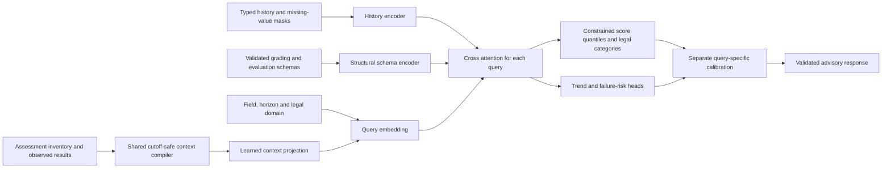

# Assessment-specific forecasting upgrade

## Objective and implementation sequence

Give each requested assessment a meaningful, privacy-safe representation and matching observed history. Different assessments may still have equal predictions when their evidence is equivalent. The acceptance criterion is useful held-out prediction, not cosmetic variation.

1. Extend the typed data contract and shared compiler for schema-bound assessment queries, instance metadata and observed assessment results.
2. Add an opt-in `assessment_context_version=1` model branch. Keep the eleven tensor input names; extend the query feature dimension from 8 to 42 only for matching version-one artifacts. Version zero retains its original model parameter shapes and behavior.
3. Compile 34 semantic features after the existing eight query descriptors: schema binding and scoring mode, relative position and scope, preceding matching observations, optional relative-time descriptors, and preceding same-type evidence across scopes. Missing evidence has explicit presence flags. Opaque IDs resolve joins and never become learned identity features.
4. Use the same compiler for ingestion, training, inference and mobile encoding. Preserve explicit constraints, query permutation/subset consistency and opaque-ID renaming invariance. Ignore results after the target's relative sequence; reject supplied observation times after the cutoff. Equal-date instances retain ties rather than receiving an artificial order from their IDs.
5. Derive relative date/ordinal metadata in the authenticated gateway from canonical assessment records at a fixed request cutoff. Share this context only under the existing assessment sharing and applied-input permissions. Never transmit absolute dates, names or reusable database IDs.
6. Require the loaded custom artifact to advertise `assessment_instance_conditioning` before using its assessment previews. An updated runtime with old weights must not claim the new feature. Legacy bundles remain usable for their supported standing/risk and typed tasks.
7. Generate varied assessment-level synthetic cohorts, freeze grouped splits and comparison budgets, and compare a legacy control with a context candidate. Select on validation, calibrate separately and open the held-out test partition only after selection. Preserve the incumbent release.
8. Verify legacy loading/resume, domain constraints, temporal cutoff safety, privacy, service conformance, ONNX dynamic parity and mobile tensor/output parity. Record synthetic results separately from real-cohort accuracy and hardware deployment checks.

## Deployment boundary

This upgrade needs a new trained artifact as well as updated runtime and gateway code. Reloading the frontend or rebuilding the runtime over the previous model cannot teach missing assessment distinctions. Existing saved forecasts remain historical advisory records and are not rewritten by installing the new service.

Production model promotion and real institutional validation remain separate from a successful synthetic demonstration.

## Why equal predictions occurred

The legacy model received the same eight query descriptors for assessments with the same field, horizon and legal domain. The adapter supplied horizon one for every assessment. The assessment reference was a response join, so changing the reference could not change the learned prediction. More training records could not resolve that missing representation.

Version one retains those eight descriptors and adds a learned projection of 34 assessment descriptors. They describe scoring mode, local schema type/component, period/group/count scope, relative sequence, and strictly earlier matching scores. A query can now attend differently to the same student's history. Equal predictions remain legitimate for equivalent evidence, tied dates, rounded integer outputs or small categorical domains. No noise or ID embedding is added to make values look different.



## Data contract and cutoff

The generic `Example` format adds optional `assessment_instances` and `assessment_results`. Existing examples with neither retain their legacy dataset fingerprint. The arrays are local to one example; the shared grading snapshot validates their relationships.

```json
{
  "queries": [{"field": "assessment_score", "horizon": 2, "assessment_ref": "local-future"}],
  "assessment_instances": [
    {"assessment_ref": "local-observed", "assessment_type_ref": "local-type", "sequence": 1,
     "maximum_score": 20, "scoring": {"mode": "linear", "maximum_score": 20}},
    {"assessment_ref": "local-future", "assessment_type_ref": "local-type", "sequence": 3,
     "maximum_score": 20, "scoring": {"mode": "linear", "maximum_score": 20},
     "relative_day": 7, "due_in_days": 8}
  ],
  "assessment_results": [{"assessment_ref": "local-observed", "value": 14, "observed_day": -2}]
}
```

This fragment illustrates the new fields; it must be combined with declared fields and a valid matching grading snapshot. Explicit generic query horizons are preserved. The APMS adapter derives its assessment horizon from the dense sequence-rank gap to the nearest strictly prior known observation, across the inventory. Ties count once; no eligible observation gives horizon one. The supported horizon range is 1–128; excessive gaps are rejected rather than silently clipped.

Instances retain their schema-bound scoring definition, maximum, optional weight, period/group refs and flags. `sequence` is a finite nonnegative relative order; equal values mean equal order. `relative_day` and `due_in_days` are optional offsets from the request cutoff, bounded to ±36,500 days. Missing offsets have zero presence flags. Their signed logarithm improves resolution near the cutoff. Counts use fixed caps of 512; percentages use a scale of 100. The exact ordered feature names, normalization identifier and cutoff semantics are recorded in metadata and verified on load.

Results contain raw grading-domain values, not an assumed percentage. Numeric mappings use their declared percentage mapping for summaries; a raw mapped score of 1 need not mean one percent. `observed_day <= 0` establishes that a result was known by the cutoff. An omitted observation day means the caller asserts it was known at cutoff. An explicit null means the score exists but its chronology is unknown: it suppresses forecasting that assessment and contributes to no temporal summary. Observations after the cutoff are rejected. A target sees only results with a strictly smaller declared sequence; tied and future targets never leak their labels into its summary.

The gateway builds date ranks and relative offsets from canonical assessment records at a fixed request cutoff. It forwards opaque local joins and numeric context through the existing assessment-sharing permission checks. Absolute dates, source database IDs, names and titles are not model features. A scheduled future date does not by itself invalidate an early recorded completion. Unknown chronology stays unknown.

Schema binding is shared by training and serving. It narrows output bounds and legal choices before encoding and gives calibration the same field/horizon/domain identity at evaluation and serving. The overall-standing target is explicit and separate from assessment score targets, so query order cannot accidentally select a categorical assessment as the standing output.

## Training, comparison and playground

`services/ai/examples/assessment-context-comparison.json` declares the synthetic data, grouped partitions, common training budget and validation-only selection rule. `compare_assessment_context.py` prepares a frozen dataset, trains a legacy control and context candidate, selects on validation, calibrates separately, and requires recorded export/contract gates before opening the final test. Each learner belongs to exactly one partition. The source snapshot and dataset digest are retained with the experiment.

For this comparison, checkpoints and early stopping follow the saved weighted multitask validation loss; the separate comparison decision uses linear-assessment RMSE in percentage points with standing, failure-Brier and AI-risk-category guards. These are different decisions. The run does not pick an epoch by looking at final test errors. Both candidates use the same dropout, weight decay, seed, model size and epoch budget. The added context projection is initialized to zero after the common parameters, so the common weights start identically and initial random differences do not masquerade as an improvement.

The assessment simulator varies learner dynamics, type/period/group effects, raw maxima of 10/20/100, linear/numeric/category mappings, missing observations and labels, and genuinely equivalent queries. Its random distributions are a test design, not an assumption about real students. It complements the existing comprehensive scalar-history simulator; neither guarantees coverage of all real populations. Adapt real records to the same typed `Example` contract, with de-identified stable learner/cohort groups and labels known only after the prediction cutoff. Existing real-first preprocessing, bounded replay, regularization, early stopping and promotion guards still apply.

This experiment isolates the context projection: both candidates receive the same meaningful generic query horizons. It is not a direct accuracy comparison against the previously deployed artifact, whose legacy APMS adapter still generates horizon one. Different datasets, horizons, missingness and score units make earlier benchmark numbers unsuitable as direct comparators.

For real-data fine-tuning, retain the version-one artifact's field meanings and primary/assessment target roles, supply the schema and inventory that were actually available at each historical cutoff, and put future outcomes only in labels. Mark records `origin: "real"`; do not relabel synthetic examples. Use the existing `finetune` command with a compatible bundle and a new output path, then re-evaluate and recalibrate on separate real groups. A saved inference-only release lacks optimizer state for exact resume; keep the original training bundle/checkpoint. Before deployment, also evaluate a later semester/institution cohort that was not used for fitting or model selection. Random group splits alone do not establish temporal generalization. Online updates remain candidate training plus held-out promotion checks, never automatic replacement of an active model after each student score.

Run the stages in a **new** output directory using the project Python environment. For example, from the repository root in Command Prompt:

```bat
set PYTHONPATH=services\ai\src
.venv\Scripts\python.exe services\ai\examples\compare_assessment_context.py prepare --output services\ai\artifacts\my-assessment-comparison
.venv\Scripts\python.exe services\ai\examples\compare_assessment_context.py train --output services\ai\artifacts\my-assessment-comparison --name context_control
.venv\Scripts\python.exe services\ai\examples\compare_assessment_context.py train --output services\ai\artifacts\my-assessment-comparison --name assessment_context_v1
.venv\Scripts\python.exe services\ai\examples\compare_assessment_context.py select --output services\ai\artifacts\my-assessment-comparison
.venv\Scripts\python.exe services\ai\examples\compare_assessment_context.py calibrate --output services\ai\artifacts\my-assessment-comparison
```

Complete the export and gateway gates before the `final` stage:

```bat
.venv\Scripts\python.exe services\ai\examples\verify_assessment_context_runtime.py --experiment services\ai\artifacts\my-assessment-comparison
.venv\Scripts\python.exe services\ai\examples\compare_assessment_context.py final --output services\ai\artifacts\my-assessment-comparison
```

The verifier checks the actual calibrated weights, exports ONNX with dynamic-shape parity, compares all eleven Python/JavaScript tensors and typed decoders, runs the mocked authenticated gateway tests, packages inference-only weights and checks authenticated HTTP inference. Its output identifies the verified release and ONNX paths. A failed attempt retains its evidence; after fixing the cause, use `--attempt runtime-review-2` for a new attempt directory. Do not create a passed gate merely to bypass verification. Keep test outcomes out of tuning and do not reuse an opened test partition for a new acceptance decision. The playground `services/ai/examples/assessment-context-playground.ipynb` demonstrates the compiler and an existing candidate without automatically retraining it.

### Selection guards and safe retries

Selection reads the **frozen run's `protocol.json`**, not the current example profile. It supports these declarations:

| Guard | Comparison |
| --- | --- |
| `standing_mae`, `standing_rmse` | Candidate increase must not exceed `standing_error_tolerance` |
| `failure_brier` | Candidate increase must not exceed `failure_brier_tolerance` |
| `ai_risk_level_accuracy` | Accuracy drop must not exceed `category_accuracy_tolerance` |
| `mapped_score_accuracy_or_mae` | Check each matched mapped-score horizon/domain: accuracy drop uses `category_accuracy_tolerance`; older numeric-only reports instead use raw-score MAE and `standing_error_tolerance` |
| `categorical_score_accuracy` | Each matched categorical-score horizon/domain must stay within `category_accuracy_tolerance` |

The two assessment guards require matching positive labeled counts. Missing metrics or unmatched domains fail the guard; an accuracy report is never compared to another model's MAE. The current example profile declares all six guards. The historical experiment reported below declared four, so a new run with stricter assessment guards can retain the control even if pooled assessment RMSE improves. Never remove a guard from a frozen protocol merely to make a candidate pass. A selected context-zero control does not enable assessment-specific previews in the app; keep those outputs disabled until a context model passes its declared checks.

An earlier runner rejected the two assessment guard names after writing `*-validation-assessment-reviewed.json`, then rejected a retry because those files existed. The corrected runner validates rules first, reuses review reports only if they match the original validation evidence, and verifies existing selection outputs rather than overwriting them. If you encountered that error, **keep the models, protocol and review files**, update `compare_assessment_context.py`, and repeat the same command:

```bat
.venv\Scripts\python.exe services\ai\examples\compare_assessment_context.py select --output services\ai\artifacts\my-assessment-comparison
```

Retraining and a container rebuild are unnecessary for this selector fix. Identical retries are safe; conflicting evidence still stops explicitly. Unknown guard names are rejected before training or selection reports are written. The PyTorch nested-tensor optimization warnings are unrelated to these selection exceptions.

For another computer, apply the source-only patch `tmp/apms-assessment-selector-fix-20261022.zip` after the original deployment archive. It updates the runner, matching example profile, tests and this guide; it contains no model files or frozen protocols. The local project already has the fix.

## Measured synthetic results, completed 2026-10-22

The frozen `assessment-context-20261020/horizon-v2` experiment contains 400 learner groups: 280 train, 40 validation, 40 calibration and 40 test. Both width-32, one-layer, four-head models ran the declared 12 CPU epochs, batch size 16, learning rate 0.001, dropout 0.1 and weight decay 0.01. Checkpoints used weighted multitask validation loss. The new candidate's validation linear-assessment RMSE was 13.204 versus 13.611 percentage points, on the same 353 labels; all four declared nonregression guards passed.

The initial selector accidentally included additional per-horizon category guards absent from the frozen protocol. That implementation mismatch was corrected before final testing, with the first decision and control calibration retained under `aborted-selection-unlisted-guards`. `independent-selection-review.json` records the declared checks and exact arithmetic. No tolerance, model setting, weight or test outcome changed the corrected selection. Earlier narrow source amendments are also recorded: legacy implicit-target/resume compatibility, avoiding redundant binding of already-bound requests, and removing observed-score summaries from export fixtures. Shared model initialization was preserved; one seed and differing stochastic training paths still limit causal conclusions.

The selected candidate was calibrated on the separate calibration groups, passed actual runtime/export checks, and was then evaluated once on the untouched test role. The following rows use identical labels for each comparison:

| Test metric | Control | Selected context model | Labeled queries |
| --- | ---: | ---: | ---: |
| Linear assessment MAE, percentage points | 11.430 | **11.030** | 355 |
| Linear assessment RMSE, percentage points | 14.009 | **13.533** | 355 |
| Numeric-mapping assessment accuracy | 54.43% | **60.13%** | 316 |
| Categorical assessment accuracy | 80.59% | **81.68%** | 273 |
| Standing RMSE, horizon 1 | 7.606 | **7.275** | 40 |
| Standing RMSE, horizon 2 | 9.531 | **8.962** | 40 |
| Failure Brier, horizon 1 | **0.03713** | 0.04076 | 40 |
| Failure Brier, horizon 2 | 0.12335 | **0.12004** | 40 |
| AI-risk-category accuracy | **71.79%** | 64.10% | 39 |
| Trend-head accuracy, horizons 1 / 2 | 87.5% / 87.5% | 87.5% / 87.5% | 40 each |

Linear-assessment RMSE decreased **3.40%** against the same-data control. Matched train-mean and last-same-type baseline RMSE were 22.073 and 15.250 percentage points respectively, both on the same 355 labels. Raw-score RMSE by maximum was 1.400→1.360 (maximum 10, n=157), 2.827→2.709 (maximum 20, n=119), and 13.839→13.385 (maximum 100, n=79). Do not pool raw errors across grading scales and call them percentage points.

These are **40 independent test learners**, with correlated assessment queries and deliberate equivalent-query duplicates for invariance checks. They are not hundreds of independent students. Both models returned exactly equal outputs for 40 equivalent-query pairs. A separate validation-input diagnostic held the original eight descriptors equal: the legacy model repeated 8.58675/10, while the trained context model returned 8.60261 and 8.55555/10 for different contexts. This establishes that the learned branch can distinguish contexts; it is not an accuracy test or a requirement that every pair differ visibly.

**The result is mixed.** The AI-risk category lost three correct classifications out of 39; horizon-one failure Brier also worsened. The control risk probabilities are uncalibrated and the selected model's are temperature-calibrated, so that row is a release-behavior comparison rather than an isolated architecture effect. Assessment category probabilities remain uncalibrated. Numeric improvement does not establish that every task improved, and test results were not used to retune or reselect the model.

**Assessment interval coverage missed its nominal target.** Only 341 of 355 linear labels matched a usable calibrated domain; their observed coverage was 286/341 = **83.87%**, against a nominal 90%. Another 14 labels had explicitly uncalibrated intervals (coverage 10/14). Standing interval coverage was 90% and 87.5% at horizons one and two, with mean widths 23.85 and 30.22 points. Sparse field/horizon/domain calibration groups and correlated outcomes limit coverage claims. A saved calibrated flag does not guarantee individual or shifted-population coverage. Do not retune intervals on this test cohort and reuse it as independent acceptance evidence.

FP32 ONNX dynamic shapes and all eleven Python/JavaScript tensors passed; four validation cases also matched typed outputs, risk probabilities and calibrated intervals. The inference-only release passed local authenticated HTTP inference, unauthenticated rejection, scored-instance suppression and capability checks. The notebook executed successfully from its nested examples directory. The initial gateway test used a live clock and failed after the pause; its clock is now fixed while timeout timers remain real, and the failed attempt is preserved.

Final software checks passed: **145 Python tests**, **118 app/domain/gateway tests**, workspace TypeScript typechecking and whitespace checks. Framework/export deprecation and tracing warnings remain; the dynamic-shape parity checks test the actual resulting graph. Legacy inference loading and exact checkpoint resume were also checked. These checks establish implementation behavior, not real-student accuracy.

Selective INT8 quantized six feed-forward matrices and passed the existing 40-example validation gate without changing its tolerances. Normalized numeric RMSE changed 0.477181→0.474561; category error 0.251758→0.254571; trend error 0.133621→0.130172; uncalibrated failure Brier 0.028520→0.028531. Maximum observed tensor discrepancy was 0.078376. Size fell from 439,364 to 420,922 bytes (**4.20%**). Matching INT8 metadata and sanitized golden outputs are included; dynamic shape checks passed at compression tolerances. No latency, CUDA, Docker or physical mobile-device result is claimed. Docker continues using the FP32 PyTorch release; the optional ONNX exports serve the portable/mobile reference path.

This is a **synthetic experimental release**, not an institutionally validated production recommendation. Real grading-policy variation, temporal/cohort shift, early-semester input availability, calibration, fairness and device performance require independent real-data evaluation. Existing official grading and evaluation engines remain authoritative. The original deployed artifact was not replaced.

## Verified artifact and rollout to the Docker computer

The verified inference bundle is:

`services/ai/artifacts/assessment-context-20261020/horizon-v2/runtime-review-2/release`

Its packaged artifact ID is `fa57985ddd9714a4ba349afd3ca598a04f560877528c6beb92a646bfcd68fe3c` (service version suffix `fa57985ddd97`). The manifest pin is `b8ff1675c960621f2c711ee426b941425c8c62495d2363c7e488e6d87b216ec0`. Use those release files together. The original calibrated training bundle has a different serialization digest because it also retains training state; its learned model parameters are identical.

`runtime-review-2/selected.onnx` and `selected.int8.onnx` have their own matching metadata, contract and conformance sidecars. Keep the quantization report with the INT8 derivative. The archive `tmp/apms-assessment-context-20261022.zip` is a source update for an **existing** APMS checkout, containing the new source and verified release/export files. It excludes environment files, secret files and account-specific `wrangler.jsonc`; its transfer manifest lists file hashes. It is not a replacement for the retained training dataset, checkpoints or full experiment evidence.

Copy the updated `services/ai/src/`, `services/ai/pyproject.toml`, Docker/deployment sources, authoritative `packages/domain/src/grading/` and `packages/domain/src/evaluation/` schemas, and the **new selected inference bundle**, including its metadata and schema files. Copy the updated `supabase/functions/apms-predictions/` and shared function files for the gateway deployment. For a frontend built on the other computer, also transfer the changed frontend sources, manifests and lockfiles using your normal source synchronization. Keep existing `.env.deploy`, secret files and account-specific Wrangler configuration on that machine; do not replace them with another machine's configuration.

Use a distinct image tag and preserve the existing image and model for rollback. From `D:\apms-docker\APMS`:

```bat
docker build --platform linux/amd64 -f services/ai/Dockerfile -t apms-ai:cpu-20261022-context .
docker build --platform linux/amd64 -f services/ai/deploy/Dockerfile.model --build-arg RUNTIME_IMAGE=apms-ai:cpu-20261022-context -t apms-ai-model:20261022-context services/ai/artifacts/assessment-context-20261020/horizon-v2/runtime-review-2/release
```

These commands use this verified context-version-one bundle. For a future comparison, use its actual verified release path. A legacy control selected by that comparison's accuracy gate cannot satisfy the new assessment capability. Preserve the previous release while improving a candidate on new validation data.

For Cloudflare native containers, push the exact image tag you built:

```bat
cd services\ai\deploy\cloudflare
npm ci
npm run check
node_modules\.bin\wrangler.cmd containers push apms-ai-model:20261022-context
```

Use the exact fully qualified image URI printed by the push in your local Wrangler container configuration, then run `node_modules\.bin\wrangler.cmd deploy`, following [Cloudflare's prebuilt-image workflow](https://developers.cloudflare.com/containers/guides/image-management/). Existing server secrets stay server-side. The gateway intentionally hides direct public health routes, so verify readiness through System Admin **Check connection**. The probe must show `assessment_instance_conditioning: true`, the intended artifact/model version, and `ready: true`. A runtime rebuilt over `release-20261017` must report this new capability false.

For ECS, push the model image to your configured private ECR repository, create a new task-definition revision using its immutable digest, existing secret references and `/models/active` configuration, and update the service to that revision. AWS documents [task-definition changes](https://docs.aws.amazon.com/AmazonECS/latest/developerguide/update-task-definition-console-v2.html) and [service task replacement](https://docs.aws.amazon.com/AmazonECS/latest/developerguide/deployment-type-ecs.html). For a Docker service reached through Cloudflare Tunnel, update the configured Compose image and recreate that service using the existing environment/keyfile overrides. For a private Supabase artifact bucket, publish the entire new release and manifest under a new immutable prefix and change the manifest pin; the runtime code must also be upgraded. See the existing [cloud deployment](AI_MODEL_CLOUD_DEPLOYMENT.md), [artifact storage](AI_MODEL_ARTIFACT_STORAGE.md) and [key management](AI_SERVICE_KEY_MANAGEMENT.md) guides for the full platform steps.

Deploy the compatible runtime and trained artifact first, verify its capability, then deploy the updated `apms-predictions` gateway and status/shared code. This change needs no database migration. A purely synthetic bundle still requires explicit synthetic-demo opt-in for a controlled demonstration and remains `institutionally_validated: false`. After updating the app, refresh AI predictions for a small class and verify saved advisory previews; old saved rows do not become newly conditioned predictions automatically. Recorded grades remain authoritative.

From the project root on your authorized Supabase deployment computer:

```bat
node_modules\.bin\supabase.cmd functions deploy apms-predictions ai-service-status --project-ref YOUR_PROJECT_REF --use-api
```

Replace the project reference with your intended deployment project and retain JWT verification. `--use-api` bundles the functions without a local Docker dependency. Copying shared files by itself does not update a hosted function; deploying these entry points includes their shared imports. Restart/reload the local app after source updates, or rebuild/redeploy its web bundle using the existing frontend workflow.

Rollback by restoring the prior runtime/image or pinned manifest together with its matching metadata. The new gateway will reject assessment preview requests against an old artifact; disable the assessment-score output if continuing legacy standing/risk forecasts during rollback.

## Files to retain and files that regenerate

Keep the new compiler/model/gateway/mobile source, tests, profile, runner, source notebook and documentation. Preserve experiment data, protocol, source snapshots, selection/calibration/test reports and trained candidates together; an ignored artifact directory is not a disposable cache. Interrupted setup runs are retained as aborted evidence and are not release candidates. Deploy only the selected verified inference bundle, never a partially written checkpoint or an aborted run.

ONNX/INT8 exports regenerate from the matching bundle, code/runtime and validation data, but active device/server exports and their metadata must remain available. Test caches and scratch files can be removed after their processes finish and unique evidence is archived. Secrets and deployment configuration are never ordinary temporary files. See [files and safe cleanup](AI_MODEL_FILES_AND_CLEANUP.md) for the full inventory.
