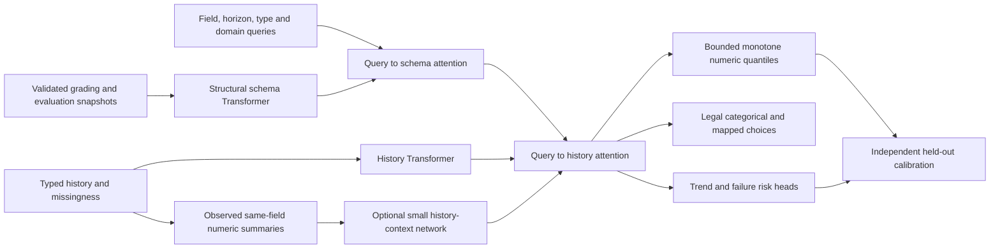

# Schema-conditioned student forecasting

## Scope and authority

The isolated `services/ai` package owns a PyTorch Transformer and Lightning Fabric training pipeline. The existing Expo → authenticated, privacy-projecting gateway → private inference service boundary remains authoritative (see `analysis/AI_PROVIDER_INTEGRATION.md`). Forecasts are advisory. The TypeScript grading engine continues computing grades, and the evaluation engine continues assigning configured risk levels. A model must never overwrite assessment results or claim institutional validation. Training and serving must not silently substitute synthetic demonstrations for configured artifacts.

## Data and schema contract

Represent each example as a history of typed, named field values, a list of future output queries, explicit feature definitions, applied grading/evaluation snapshots, and optional labels. Float, integer, boolean, and categorical values have explicit type information. Null means missing, never zero. History and forecast lengths, field sets, and categories can vary between examples. Sequences use relative time/order rather than identifiable dates. Local training group keys exist only to prevent leakage; they never become predictive features or provider-facing data.

Validate snapshots against the repository's draft-2020-12 JSON schemas, then validate references, acyclic component relationships, scope/count/weight requirements, and assessment mappings. Compile assessment/factor references into output constraints. Unsupported or ambiguous constraints fail explicitly. The component-based example declares `asg`/`ho` assessment types but references `assignment`/`hands-on`; the existing domain validator rejects those unresolved references. Report that inconsistency clearly, preserve the original example, and require an explicitly corrected representation rather than inventing aliases.

Compile a representation's structural/numeric information into model context: node kinds, relative entity indices, referenced relationships, weights (including fractions), modes, sequences, count limits, mapping values and percentages, factor ranges/types/categories, classification thresholds and policies. Ignore display names and descriptions. Fresh opaque identifiers resolve relationships locally; they are not learned identities. The same numeric evidence under different schema snapshots can therefore produce different predictions. The model can accept new representations within supported semantics without rebuilding its heads. Semantic generalization to unseen policies must still be measured.

Fit robust numeric transforms on the training partition alone. Prefer real training records when available; retain transforms and vocabulary/contract versions with artifacts. Bound normalization where schemas provide finite bounds; support unbounded values via invertible robust transforms. Typed tokens include missingness, time, field identity within the supplied contract, and schema descriptors. Reject NaN/infinity, invalid types, unknown categories, invalid references, and oversized requests. Limits are configuration, not implicit truncation.

## Network

A shared encoder attends over observed typed field/time tokens and schema context. Query tokens describe each requested output and future position; cross-attention to the encoded past provides direct multi-horizon sequence-to-sequence forecasts without teacher-forcing leakage. Variable tensor lengths use explicit masks, including a valid context token for empty histories. Attention uses exportable tensor operations.

Shared heads produce numeric quantiles, categorical logits, trend logits, and binary failure logits. The numeric head uses monotone quantile parameterization and schema-bound transforms. In fresh training runs, `numeric_residual` defaults to true: the median starts at zero correction around the last observed numeric value for the same queried field, while monotone quantile spreads start narrow. A query with no observed numeric anchor starts from the saved training median with the additive link, or the absolute bounded path with the logit link. The anchor is request-local observed history, never a label or a learned student identity. Legacy artifacts default to absolute mode; resume and supervised fine-tuning inherit saved head semantics and reject incompatible changes.

`input_dropout` (default 0.05) is training-only masking of observed numeric, boolean, and categorical history tokens. It zeros the token value and changes its kind to the corresponding missing kind; validation, calibration, and test inputs remain unchanged. `numeric_center_loss_weight` (default 0.25) adds SmoothL1 loss on the median quantile in normalized target units alongside pinball loss. It does not introduce a parametric outcome assumption. `min_delta` controls the minimum weighted validation loss improvement required to reset early stopping. These training settings are saved in the artifact configuration.

Integer outputs round inside their valid integer domain. Boolean and categorical outputs use masked legal choices. Numeric mappings predict an allowed mapped raw value rather than an interpolated illegal value. These are constraints in the forward/decode path, followed by strict output validation; malformed outputs are never silently clamped into acceptance. Quantile regression avoids a parametric outcome-distribution assumption; prediction intervals receive split-conformal calibration on a dedicated held-out calibration partition. Conformal marginal coverage depends on exchangeability and adequate calibration size; it does not guarantee individual coverage or survive arbitrary drift. Risk probabilities use held-out temperature calibration and remain unvalidated on real data until real outcomes are available. Risk classifications belong to the configured domain criteria engine.

Masked pinball, categorical cross-entropy, trend cross-entropy, and binary cross-entropy losses support partially labeled real data. Task weights, dropout, AdamW weight decay, gradient clipping, patience, and capacity are configurable. No data-origin indicator, student key, future label, or missing-future-value sentinel may become a predictive shortcut.

Fresh residual training defaults to `residual_link=additive`. A zero-initialized neural median correction adds to the latest observed numeric value of the same field; positive spreads form ordered quantiles around it. The graph bounds these quantiles using the applied normalized domains. This leaves useful correction gradients at zero/full marks where a logit anchor can saturate. Missing anchors start at normalized zero, representing the saved training median, before applying bounds. Existing residual bundles without a link setting retain their original `logit`/softplus behavior. Supervised fine-tuning rejects changes of head mode/link; transfer from masked pretraining may reset the numeric head while retaining encoder weights.

`numeric_history_context=true` adds a small query-local summary network. For the requested numeric field it reads the latest and previous observed values, their difference, mean, standard deviation, minimum, maximum, observed-token fraction, relative last-token age, and availability flags. Missing values, other fields and padding are excluded. These are summaries of observations, not an assumed trajectory or elapsed-time regression. Token age does not represent physical days. Values are clipped in normalized units for summary stability; the original Transformer input and persistence anchor retain their original values. Both context projections start at zero so enabling the branch introduces no initial learned correction. Shared parameters have identical seeded initialization with the branch enabled or disabled, making the residual-control comparison more informative.

The branch feeds the shared forecast representation and a direct numeric correction before schema bounds and ordered quantile construction. It uses the existing eleven inputs and four outputs, so serving and mobile encoders need no new tensor contract. Summaries normalize by each learner's unpadded history, keeping predictions independent of other learners' sequence lengths. Empty, singleton and constant histories have explicit finite behavior. Existing artifacts omit the branch by default; supervised fine-tuning preserves its saved setting, while masked pretraining can transfer the encoder and initialize new branch parameters.

`numeric_center_loss_kind=mse` optionally emphasizes large normalized center errors instead of SmoothL1. Combining this objective with pinball loss trades pure conditional-median estimation for a point forecast influenced by squared error; the center should not be interpreted as an exactly optimized median. Ordered interval endpoints still train with pinball loss and need independent calibration. This is a loss choice, not a Gaussian likelihood or a distributional guarantee.

## Training lifecycle

1. Ingest validated JSON/JSONL and a documented CSV adapter; retain origin, group, chronology and label provenance separately from features.
2. Split by independent student/group, with explicit train/validation/calibration/test roles and overlap checks. Temporal deployment evaluations use later cohorts/forward cutoffs. Never fit preprocessing, tune, stop, or calibrate on test outcomes.
3. Generate seeded synthetic families with varied latent dynamics, noise, correlations, missingness, lengths, schemas and distributions. Synthetic labels describe the generator only. No generator can guarantee absence of simulation bias.
4. Optional masked-observation reconstruction pretraining precedes supervised multi-task learning.
5. Tune on validation using seeded Optuna trials, preferring real validation when present. Compare persistence/mean baselines; report per-task, horizon and source metrics, PR-AUC/AUROC where defined, Brier score and interval coverage/width. Single-class or missing-label metrics are explicitly unavailable.
6. Fabric manages CPU/CUDA device, precision, backward and checkpoint state. Seed Python/NumPy/Torch/workers; save model, optimizer, configuration, preprocessing, calibration, source counts, split fingerprints and RNG state. Resume preserves training state; finetuning intentionally starts a new optimizer and calibration lifecycle.
7. Real data has configurable priority in training and exclusively controls model selection/calibration when suitable real partitions exist. Tune bounded synthetic replay to prevent forgetting; do not present synthetic validation as real accuracy.
8. Online updates are offline candidate training on labeled observations plus bounded replay. They never train in an inference request. Require disjoint held-out real-data non-regression checks, recalibration, and explicit promotion. Keep incumbent artifacts for rollback.

Checkpoint selection can use `selection_metric=numeric_rmse`, the square root of total normalized numeric squared error divided by the observed numeric label count on validation. It excludes absent labels and fails when no numeric validation labels exist. This score allows numeric-error-focused stopping across fields with different raw units; raw per-field/horizon RMSE is logged separately. The default remains `weighted_loss` for compatibility. `best_validation_score` identifies the stopping criterion, while `best_validation_loss` records weighted task loss at the selected epoch. Settings are part of exact-resume validation. Selection and calibration remain separate from final test evaluation; changing the criterion after looking at test outcomes would contaminate the test.

## Deployment and operations

Versioned artifact bundles carry weights, training metadata, transforms, supported contract, calibration and hashes. Serving loads trusted local weights in evaluation mode with inference guards; no import-time training. Authentication is a server-only token, readiness fails closed without an artifact, and synthetic artifacts require explicit development opt-in. Keep an adapter compatible with the existing privacy-projected custom-provider payload and strict domain output validators.

Export the tensor core to ONNX with explicit input/output names and dynamic history/query axes, plus preprocessing and schema/decode contract metadata and a conformance fixture. Check PyTorch/ONNX parity across lengths before returning success. Dynamic INT8 quantization has a held-out accuracy/parity gate. A smaller configurable student can be distilled from a teacher for compression. CPU ONNX Runtime is the portable mobile baseline; Android/iOS acceleration and latency require device verification. Do not claim mobile integration from an exported file alone.

SHAP wraps numeric inference with a fixed schema/query and documented training background; explain predictions, not causes. Bound work and redact raw values from logs. Structured training logs, health/readiness, request latency/error counters, drift summaries and diagnostic checks support monitoring. Containers run privately as a non-root user with read-only artifacts and configurable CPU/GPU runtime. Promotion remains independent of deployment infrastructure.

## Evidence and limits

Acceptance requires deterministic data generation/splits, mixed-type and missing-data tests, valid/invalid schema fixtures, dynamic schema conditioning, forward/backward tests, artifact round trips and resumed training, fine-tuning/online safeguards, calibration separation, authenticated service behavior, ONNX dynamic-shape parity and INT8 evaluation. A runnable notebook exercises the same public API. GPU and mobile hardware checks are recorded separately if unavailable. High accuracy is a validation objective, never a guarantee in the absence of representative real outcomes.

See [measured validation evidence and outstanding checks](AI_MODEL_VALIDATION.md). History order is supplied by the caller; irregular physical time needs an explicit elapsed-time feature. Horizon units must be consistent within each trained field contract.

## API references

- [Fabric lifecycle and checkpoint API](https://lightning.ai/docs/fabric/latest/api/generated/lightning.fabric.fabric.Fabric)
- [PyTorch ONNX export](https://docs.pytorch.org/docs/stable/onnx.html)
- [ONNX Runtime quantization](https://onnxruntime.ai/docs/performance/model-optimizations/quantization.html)
- [ONNX Runtime mobile deployment](https://onnxruntime.ai/docs/tutorials/mobile/)
