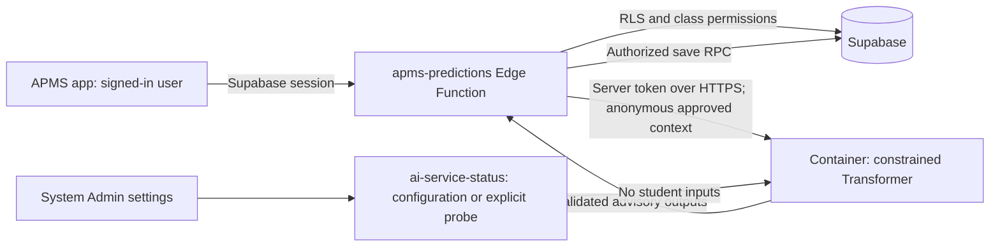

# Deploy the APMS forecasting service

The source can stay on this PC. Build and run Docker images on your other computer or a build runner. No Docker installation on this PC is required to edit the app, run its TypeScript checks, or deploy Supabase Edge Functions with `--use-api`. Commands below use Windows `cmd.exe` from the repository root unless another directory is specified. Replace example account IDs, paths, domains, image tags and project references before running deployment commands.

The deployment contains the inference service only. Training, fine-tuning, calibration and online learning produce separate candidate bundles; inference never modifies a model or connects directly to the student database. Current synthetic models remain demonstrations. Containerization does not establish real-world accuracy or institutional validation; see [validation evidence](AI_MODEL_VALIDATION.md).

Use [service key management](AI_SERVICE_KEY_MANAGEMENT.md) for AWS Secrets Manager, protected Docker files, Cloudflare Tunnel/Access credentials and native Worker secrets. It includes coordinated rotation, required worker restarts, rollback and safe verification without printing tokens.

## Choose where it runs

| Option | Where Docker runs | Public HTTPS boundary | Included configuration |
| --- | --- | --- | --- |
| Other computer + Cloudflare Tunnel | Your other computer, kept online | Cloudflare Access and Tunnel | `compose.yaml`, `compose.keyfile.yaml`, `compose.cloudflare.yaml` |
| AWS ECS Fargate | Build computer; AWS runs the image | HTTPS Application Load Balancer | `deploy/aws-fargate.yaml` |
| Cloudflare Containers | Build computer; Cloudflare runs the image | Authenticated Worker | `deploy/cloudflare/` |

All three paths use the same Python model and Supabase gateway. Cloudflare Pages can host the Expo web frontend separately; the PyTorch process belongs in a container. The checked-in images target CPU inference. GPU training/fine-tuning remains an offline job using the existing Fabric commands and a compatible CUDA environment; AWS GPU hosting would require an appropriate GPU service/image rather than this Fargate template.

An alternative to mounting/baking the model is [private Supabase artifact storage with a verified startup cache](AI_MODEL_ARTIFACT_STORAGE.md). That guide covers the private bucket migration, machine-authenticated artifact broker, manifest pinning, uploads, the remote-storage Compose variant and optional AWS/Cloudflare settings. The remaining authentication, privacy, schema validation and release-quality checks in this guide still apply. The worker downloads once when its pinned cache is missing, then predicts from memory.

The app's Gradebook Full View, At-Risk and AI Prediction actions share the authenticated gateway; larger classes use separate bounded batches with partial-completion reporting. Saved forecasts also feed existing class monitoring/detail/report views. See [the app integration guide](AI_MODEL_APP_INTEGRATION.md) for currentness limits, read-only previews and probability/confidence semantics.



## What is integrated with APMS

- The gateway verifies the user's Supabase session and class access, checks that enrollments belong to the class, loads authoritative applied grading/evaluation schemas, and rejects conflicting snapshots. It retains the global AI, assessment-sharing and attendance-sharing controls and the requested input/output allowlists.
- Only the anonymous privacy projection leaves Supabase. Duplicate enrollments, malformed requests, oversized UTF-8 payloads, mismatched response record references and schema-incompatible values fail before saving a prediction run. No partial model batch is saved.
- The container checks its own bearer token and validates schemas, typed inputs, artifact hashes and output constraints. Its token is a machine credential held only by server infrastructure. The worker does not need a Supabase service-role key.
- System Admin → System Settings includes **APMS forecasting service**. Refresh loads configuration without contacting the worker. **Check connection** explicitly probes the authenticated worker. The server checks an active account and a currently valid global `system_admin` role; hiding a UI card is not the authorization boundary. The response excludes endpoint addresses, tokens, input contracts and local paths.
- **Monthly APMS model forecasts** controls `ai.custom.monthly_request_limit`: blank/JSON `null` is unlimited, `0` blocks forecasts, otherwise enter a whole number through 2,147,483,647. One submitted student record reserves one forecast, regardless of how many assessment outputs it requests. An atomic database reservation precedes outbound calls; failed attempts remain counted. Connection checks do not consume forecast quota. Usage appears as provider `custom` in the existing usage table and is separate from OpenAI/Gemini token limits.
- To select this service for a class, choose **APMS forecasting service (custom)** in the evaluation-criteria AI provider control, configure supported input features/outputs and apply that criteria representation through the existing workflow. Merely deploying a container does not change an applied class schema. The actual worker version is saved with each run.

The grading/risk rule engines remain authoritative; these outputs are advisory. `institutionally_validated` remains `false` in the current service contract, including when training contains real records. A successful readiness check is an operational check.

## 1. Prepare the release and transfer it

Keep the repository revision and selected immutable calibrated bundle together in your release record. On this PC, with the AI Python environment installed:

```bat
.venv\Scripts\python.exe services\ai\deploy\package_model.py --bundle services\ai\artifacts\candidate-calibrated --output services\ai\artifacts\release-20261017
```

Choose a new output directory; packaging refuses to overwrite one. It verifies the source bundle and writes inference weights, metadata and matching schema files. It removes optimizer/RNG state. Treat the model, preprocessing/vocabularies and any retained metadata as protected institutional artifacts; packaging is not anonymization of a training dataset or a guarantee that learned weights reveal nothing. Preserve the original bundle and experiment evidence for retraining and rollback.

Transfer the reviewed repository revision and that bundle through an approved channel to the Docker computer. Ignored artifacts are **not** included in a Git clone. Do not transfer `.venv`, caches, raw student data, training checkpoints, or the whole `tmp` folder just to run inference. Create deployment credentials on the target or retrieve them from its secret manager.

Check `runtime_versions` in the bundle's `metadata.json`. The Dockerfile exposes `PYTHON_IMAGE` and `TORCH_CPU_VERSION` build arguments. A Linux CPU wheel must exist for the chosen Python/architecture; match the validated training/export runtime where possible. The default CPU image is not proof of compatibility with a bundle trained on a newer local Torch version. Before release, run startup and prediction/parity checks in the actual image and compare held-out outputs/metrics with the source environment. A changed runtime requires that check even if model loading succeeds. For repeated builds, pin an approved Python image digest and record the resolved image/dependency inventory.

## 2. Run Docker on the other computer

Install Docker with Linux-container support on that computer and verify `docker info`. The worker runs as UID 10001; ensure it can read the mounted bundle and secret files. Use target-computer absolute paths with forward slashes in the environment file.

```bat
copy services\ai\deploy.env.example services\ai\.env.deploy
notepad services\ai\.env.deploy
```

Set `APMS_MODEL_HOST_PATH` to the target's release bundle. For the secret-file configuration, clear `APMS_AI_SERVICE_API_KEY`, set `APMS_AI_KEY_HOST_PATH` to a file containing only a strong random service token, and store that file in the ignored `services/ai/secrets/` directory with restricted host permissions. Do not put a token in a Dockerfile, image build argument, repository, frontend environment, command history or screenshot. Retain the same token securely for the Supabase secret in step 3.

`APMS_AI_ENABLE_SYNTHETIC_DEMO=false` is the default. Only for an explicit synthetic demonstration, set it to `true`; otherwise a synthetic-only artifact fails readiness. Request bytes, worker concurrency, CPU threads and loopback port are configurable in the environment example. Start with one or two concurrent requests and measure memory/latency before increasing them.

```bat
docker compose --env-file services\ai\.env.deploy -f services\ai\compose.yaml -f services\ai\compose.keyfile.yaml up -d --build
docker compose --env-file services\ai\.env.deploy -f services\ai\compose.yaml -f services\ai\compose.keyfile.yaml ps
curl.exe --fail http://127.0.0.1:8080/ready
```

The port is bound to loopback, the model is mounted read-only, the root filesystem is read-only, `/tmp` is temporary, capabilities are dropped, and the service runs one process. `/health` is liveness; `/ready` also requires the model and key. `/v1/status`, `/metrics`, `/v1/predictions` and `/v2/forecasts` require service authentication. Use the System Admin probe once HTTPS routing is ready instead of typing the token into a test command.

Hosted Supabase cannot reach `127.0.0.1` on your other PC. Choose the Tunnel route in section 4 or one of the hosted container routes before configuring the production URL. Do not forward port 8080 publicly.

## 3. Deploy the Supabase integration and settings

Use the **existing** APMS Supabase project. The new migration is `supabase/migrations/20261017092935_ai_custom_service_usage.sql`; it adds the restricted custom-usage reservation function and a quota setting, using the existing usage table. The rest of the APMS schema/migrations must already be present. Review migration history and the dry-run before applying changes; these commands intentionally target a named/linked project and never reset it:

```bat
node_modules\.bin\supabase.cmd login
node_modules\.bin\supabase.cmd link --project-ref YOUR_EXISTING_PROJECT_REF
node_modules\.bin\supabase.cmd migration list --linked
node_modules\.bin\supabase.cmd db push --linked --dry-run
node_modules\.bin\supabase.cmd db push --linked
```

If the later `20261017120000` migration is already recorded remotely and the new earlier-timestamp migration is missing, inspect `db push --linked --include-all --dry-run`, then use `--include-all` only after reviewing **every** missing migration it would apply. Do not repair migration history blindly or run `db reset` on hosted data. Test the migration/RLS against a staging project first. Local full Supabase testing can run on the Docker computer using the repository's normal schema tests.

Copy `supabase/functions/.env.example` to an ignored private file, for example `supabase/functions/.env.ai-production`. Fill the following server secrets; remove placeholder/unrelated provider entries from this private file so they cannot replace working OpenAI/Gemini/Resend settings:

| Supabase Edge secret | Value |
| --- | --- |
| `APMS_AI_SERVICE_URL` | HTTPS origin/base path, without `/v1/predictions`, query, fragment or embedded credentials |
| `APMS_AI_SERVICE_API_KEY` | Same token loaded by the worker |
| `APMS_AI_SERVICE_MODEL` | Optional stable usage/display label, e.g. `apms-transformer` |
| `APMS_AI_CF_ACCESS_CLIENT_ID` | Tunnel/Access service-token ID, only if using Access |
| `APMS_AI_CF_ACCESS_CLIENT_SECRET` | Matching Access secret; both Access values must be set together |
| `APMS_AI_ALLOW_INSECURE_HTTP` | `false` in production |

`APMS_AI_SERVICE_MODEL_VERSION` remains accepted for legacy configuration; saved custom runs use the authenticated worker's actual version. Supabase provides its own `SUPABASE_URL`, anon key and service-role secret to Edge Functions; do not put service-role credentials into the app or worker. For local development only, insecure HTTP requires an explicit opt-in and a loopback/`host.docker.internal` host. Hosted functions still cannot reach your PC's loopback.

```bat
node_modules\.bin\supabase.cmd secrets set --env-file supabase\functions\.env.ai-production --project-ref YOUR_EXISTING_PROJECT_REF
node_modules\.bin\supabase.cmd functions deploy apms-predictions --project-ref YOUR_EXISTING_PROJECT_REF --use-api
node_modules\.bin\supabase.cmd functions deploy ai-service-status --project-ref YOUR_EXISTING_PROJECT_REF --use-api
```

Keep JWT verification enabled; both functions also validate user sessions themselves. `--use-api` uses Supabase's bundler so these deployment steps do not need local Docker. Secret deployment is separate from a frontend build. See [Supabase function secrets](https://supabase.com/docs/guides/functions/secrets) and [function authentication](https://supabase.com/docs/guides/functions/auth).

Build/deploy the updated app using its existing release workflow and existing `EXPO_PUBLIC_SUPABASE_URL` / publishable-key configuration. Add no worker secrets to `EXPO_PUBLIC_*`. Sign in as an active global System Admin, review the AI/privacy switches, set a forecast quota, save settings, refresh the service configuration and run **Check connection**. With an authorized faculty account and a compatible applied custom-provider schema, test a small class batch. Confirm the saved advisory values, worker model version and custom usage row. Check that an unrelated class and a non-admin status request are denied.

## 4. Cloudflare Tunnel to your other Docker computer

This option keeps compute on your computer; Cloudflare supplies the HTTPS route. The computer and Docker must stay online. In Cloudflare Zero Trust, create a remotely managed tunnel and route an owned hostname such as `ai.example.edu` to **`http://ai:8080`**. `ai` is the Compose service name on the shared Docker network, not `localhost` inside the connector.

Before using that hostname, protect it with a self-hosted Access application covering the whole host/path and a **Service Auth** policy allowing only the dedicated service token. Do not use an interactive login policy for the Edge Function, a public bypass, or the single-header token mode: the worker already uses `Authorization: Bearer ...`. Supabase sends Access's separate `CF-Access-Client-Id` and `CF-Access-Client-Secret` headers. Check account policy settings so service-token requests really require Service Auth. See [Access service tokens](https://developers.cloudflare.com/cloudflare-one/access-controls/service-credentials/service-tokens/).

Store the tunnel connector token in a separate protected file, set `APMS_CF_TUNNEL_TOKEN_HOST_PATH`, and choose an approved `CLOUDFLARED_IMAGE` tag/digest in `.env.deploy`. The tunnel token, Access client secret and worker bearer token are **three different credentials**. The overlay uses `--token-file` rather than placing the connector token in its process command; this requires cloudflared 2025.4.0 or newer. See [Tunnel run parameters](https://developers.cloudflare.com/cloudflare-one/networks/connectors/cloudflare-tunnel/configure-tunnels/run-parameters/).

```bat
docker compose --env-file services\ai\.env.deploy -f services\ai\compose.yaml -f services\ai\compose.keyfile.yaml -f services\ai\compose.cloudflare.yaml up -d --build
docker compose --env-file services\ai\.env.deploy -f services\ai\compose.yaml -f services\ai\compose.keyfile.yaml -f services\ai\compose.cloudflare.yaml ps
```

Set Supabase's service URL to `https://ai.example.edu` and its Access secret pair, then deploy the secrets as in section 3. An unauthenticated public request must be stopped by Access; a request with Access credentials but no worker bearer token must be rejected by the worker. Do not expose the loopback port through a second unprotected route. Readiness probes run locally inside Docker and do not need an Access bypass.

## 5. Build an image containing the approved model

AWS and native Cloudflare Containers cannot use your PC's bind mount. Build a release image with the approved packaged model included. Run these commands on the Docker computer after transferring the repository and release bundle:

```bat
docker build --platform linux/amd64 -f services/ai/Dockerfile -t apms-ai:cpu .
docker build --platform linux/amd64 -f services/ai/deploy/Dockerfile.model --build-arg RUNTIME_IMAGE=apms-ai:cpu -t apms-ai-model:20261017 services/ai/artifacts/release-20261017
```

The second command's build context is **only** the packaged inference bundle. Do not substitute the repository root or raw training/checkpoint directory. The root `.dockerignore` keeps model files, caches and deployment secrets out of the generic runtime build; the dedicated release context intentionally includes inference weights. Record the source revision, source bundle hash, packaged bundle hash, build arguments, image digest and runtime parity result. Test the image with the same secret file and synthetic opt-in policy before pushing it. A local image test can use an ignored env file containing runtime variables and `docker run --env-file`, a read-only secret mount and loopback port mapping; do not bake secrets into either image.

## 6. AWS ECS Fargate

The template creates an ECS cluster, one-CPU/4-GiB Fargate task definition, CloudWatch logs (30-day retention), an internet-facing HTTPS ALB, private tasks, restricted security groups and execution roles. There is no database credential or S3 training-data access in the task. The execution role retrieves the one named service-token secret and pulls the image; the application task role has no extra permissions.

Prepare an existing VPC with at least two public ALB subnets in different availability zones and private task subnets, a valid ACM certificate in the deployment region covering your AI hostname, an ECR repository, and an AWS Secrets Manager secret whose **raw string** is the worker token. Private tasks need NAT or the appropriate ECR/CloudWatch/Secrets Manager endpoints and ECR layer-download connectivity; this template does not create your VPC/NAT/endpoints. Outbound task HTTPS is needed for those platform services. Review [Fargate task networking](https://docs.aws.amazon.com/AmazonECS/latest/developerguide/fargate-task-networking.html) and [private outbound access](https://docs.aws.amazon.com/AmazonECS/latest/developerguide/networking-outbound.html).

Use AWS CLI with an authorized deployment identity. Set non-secret convenience values:

```bat
set AWS_REGION=ap-southeast-1
set AWS_DEFAULT_REGION=%AWS_REGION%
set AWS_ACCOUNT_ID=123456789012
set AI_REPOSITORY=apms-ai
set AI_RELEASE=20261017
aws ecr create-repository --repository-name %AI_REPOSITORY% --image-tag-mutability IMMUTABLE --image-scanning-configuration scanOnPush=true
aws ecr get-login-password --region %AWS_REGION% | docker login --username AWS --password-stdin %AWS_ACCOUNT_ID%.dkr.ecr.%AWS_REGION%.amazonaws.com
docker tag apms-ai-model:20261017 %AWS_ACCOUNT_ID%.dkr.ecr.%AWS_REGION%.amazonaws.com/%AI_REPOSITORY%:%AI_RELEASE%
docker push %AWS_ACCOUNT_ID%.dkr.ecr.%AWS_REGION%.amazonaws.com/%AI_REPOSITORY%:%AI_RELEASE%
aws ecr describe-images --repository-name %AI_REPOSITORY% --image-ids imageTag=%AI_RELEASE% --query imageDetails[0].imageDigest --output text
```

Skip repository creation if it already exists. Use the resulting `repository@sha256:...` in the template parameters; avoid a moving tag. These commands follow [ECR image publishing](https://docs.aws.amazon.com/AmazonECR/latest/userguide/docker-push-ecr-image.html).

Create the token in Secrets Manager through its secure console flow or from the protected token file:

```bat
aws secretsmanager create-secret --name apms/ai/service-token --secret-string file://services/ai/secrets/service-token.txt
```

Do not copy the token itself into the CLI. Save its returned ARN. If the secret uses your own KMS key, set `KmsKeyArn` and authorize the execution role in that key policy. Rotation requires fresh ECS tasks; environment-injected secrets are not refreshed inside a running process. See [ECS secret injection](https://docs.aws.amazon.com/AmazonECS/latest/developerguide/secrets-envvar-secrets-manager.html).

Create an ignored local parameter file such as `services/ai/.env.aws-parameters.json` containing this AWS CLI parameter-array format, replacing every example:

```json
[
  {"ParameterKey":"VpcId","ParameterValue":"vpc-EXAMPLE"},
  {"ParameterKey":"PublicSubnetIds","ParameterValue":"subnet-PUBLIC1,subnet-PUBLIC2"},
  {"ParameterKey":"PrivateSubnetIds","ParameterValue":"subnet-PRIVATE1,subnet-PRIVATE2"},
  {"ParameterKey":"CertificateArn","ParameterValue":"arn:aws:acm:ap-southeast-1:123456789012:certificate/REPLACE"},
  {"ParameterKey":"ImageUri","ParameterValue":"123456789012.dkr.ecr.ap-southeast-1.amazonaws.com/apms-ai@sha256:REPLACE"},
  {"ParameterKey":"ServiceTokenSecretArn","ParameterValue":"arn:aws:secretsmanager:ap-southeast-1:123456789012:secret:apms/ai/service-token-REPLACE"},
  {"ParameterKey":"DesiredCount","ParameterValue":"1"},
  {"ParameterKey":"AllowSyntheticDemo","ParameterValue":"false"}
]
```

Validate, generate a change set and inspect its resources before executing it. This provisions billable AWS resources:

```bat
aws cloudformation validate-template --template-body file://services/ai/deploy/aws-fargate.yaml
aws cloudformation create-change-set --stack-name apms-ai --change-set-name initial-ai --change-set-type CREATE --template-body file://services/ai/deploy/aws-fargate.yaml --parameters file://services/ai/.env.aws-parameters.json --capabilities CAPABILITY_IAM
aws cloudformation wait change-set-create-complete --stack-name apms-ai --change-set-name initial-ai
aws cloudformation describe-change-set --stack-name apms-ai --change-set-name initial-ai
aws cloudformation execute-change-set --stack-name apms-ai --change-set-name initial-ai
aws cloudformation wait stack-create-complete --stack-name apms-ai
aws cloudformation describe-stacks --stack-name apms-ai --query Stacks[0].Outputs
```

Use an UPDATE change set for an existing stack. Configure your owned AI hostname as a DNS alias/CNAME to the output ALB DNS name; the certificate must match that hostname. The ALB's default AWS hostname is not covered by your certificate. Set Supabase's URL to `https://YOUR_AI_HOSTNAME`; leave the Access secret pair unset unless separately fronting this hostname with Access. Check healthy ECS targets, then the admin probe and an authorized end-to-end forecast. This template is for commercial AWS regions using `amazonaws.com`; review partition-specific changes for other regions.

Start with `DesiredCount=1`; measure before scaling. Requests are stateless and every task loads the same immutable bundle. The template supports a fixed desired count, not an autoscaling policy. Add institutional alarms for unhealthy targets, 5xx rates, task restarts, memory/CPU and latency. Do not log payloads or add student identifiers as log dimensions. Keep ECR release digests and the prior task definition for rollback; ECS's deployment circuit breaker rolls back failed deployments, while model quality rollback remains an explicit release decision.

## 7. Native Cloudflare Containers

This path runs the Python image on Cloudflare, with a small Worker controlling access. It requires an account/plan supporting Containers. The starter uses one fixed container identity, an initial `standard-2` instance, a five-minute idle sleep and CPU inference. Cold starts can make an initial connection check time out; retry the explicit check after provisioning, rather than increasing traffic immediately. See [Containers setup](https://developers.cloudflare.com/containers/get-started/) and [current instance limits](https://developers.cloudflare.com/containers/platform/limits/).

The Worker authenticates the service bearer token before starting a container, bounds actual request bytes, and forwards only `POST /v1/predictions` and `GET /v1/status`. Query strings and other routes are rejected. The Python service authenticates again. No student identifier selects a container, and nothing trains or writes a model to its ephemeral disk. Direct typed `/v2/forecasts` and `/metrics` are deliberately absent from this gateway's route list; use the platform metrics and existing Supabase gateway. The model is included at `/models/active` in the release image.

On the Docker computer, install the isolated deployment dependencies and authenticate Wrangler:

```bat
cd services\ai\deploy\cloudflare
npm ci
node_modules\.bin\wrangler.cmd login
npm run check
```

Publish the previously tested `linux/amd64` image to your account's Cloudflare registry:

```bat
node_modules\.bin\wrangler.cmd containers push apms-ai-model:20261017
```

Use the fully qualified reference printed by that command (such as `registry.cloudflare.com/YOUR_ACCOUNT_ID/apms-ai-model:20261017`) for `containers[0].image` in `wrangler.jsonc`; replace `REPLACE_WITH_ACCOUNT_ID`. The image was already built with the model in section 5. The alternative `wrangler containers build DIRECTORY --tag NAME:TAG --push` builds and pushes a Dockerfile, but its current CLI does not accept the runtime build argument required by `Dockerfile.model`. Use a unique release tag and retain its digest in the release record. See [Cloudflare image management](https://developers.cloudflare.com/containers/guides/image-management/). The config uses the current `exports` declaration for SQLite-backed Durable Objects; do not add legacy `migrations` alongside it.

Set the Worker secret interactively, supplying the same bearer token as Supabase without placing it in the command:

```bat
node_modules\.bin\wrangler.cmd secret put APMS_AI_SERVICE_API_KEY
node_modules\.bin\wrangler.cmd deploy
node_modules\.bin\wrangler.cmd containers list
node_modules\.bin\wrangler.cmd containers images list
```

Leave synthetic mode `false` for real deployment; set the explicit development flag only for an agreed synthetic demo. Wrangler needs Docker when building an image from a Dockerfile; building/pushing on the other computer and referencing the published image avoids that build on this PC. Record the deployed Worker version and image reference. Set Supabase's service URL to the HTTPS Worker/custom-domain URL with no trailing API route, then use the System Admin check and authorized forecast workflow. Optional Cloudflare Access protection can be added as with the Tunnel route; if so, configure the paired Access secrets too.

## 8. Host the APMS web app

The Expo app is configured for static web output. Set the existing public Supabase URL/publishable key, `EXPO_PUBLIC_DEMO_MODE=false`, and error-detail debugging to `false` in the build environment. Rebuild after changing public environment values: they are embedded in the JavaScript bundle. Keep all model, Access, service-role and provider credentials in server secrets. From the repository root:

```bat
npm ci
npm run build
```

The output directory is `apps/mobile/dist`. The app, model container and Supabase can live on different hosts: the client still calls Supabase. This frontend build does not contain or host the PyTorch model.

**Cloudflare Pages:** use the repository root as the build root, `npm run build` as the build command, and `apps/mobile/dist` as the output directory. Configure the public environment values in the build settings. For direct upload, use the pinned deployment Wrangler from the root:

```bat
services\ai\deploy\cloudflare\node_modules\.bin\wrangler.cmd pages deploy apps\mobile\dist --project-name YOUR_EXISTING_PAGES_PROJECT
```

Ensure direct loads/refreshes of `/portal/faculty/overview`, the System Admin settings route and `/reset-password` work. The dynamic `/portal/[role]/[view]` route requires an SPA fallback for concrete portal paths. For Pages, add `/portal/* /index.html 200` to a deployment `_redirects` file copied into the output (or maintain it in `apps/mobile/public` in your frontend release configuration). Keep static assets served normally. See [Pages redirect/proxy rules](https://developers.cloudflare.com/pages/configuration/redirects/). This routing rule only loads the app shell; application route guards and Supabase RLS still authorize data access.

**AWS:** use a dedicated private S3 bucket with Block Public Access enabled and a CloudFront distribution using Origin Access Control, an HTTPS viewer policy and your web certificate/domain. Use the regular S3 origin rather than its website endpoint; grant only that CloudFront distribution read access. Set the default root object to `index.html`. Configure concrete portal URLs to fall back to `index.html` using your CloudFront routing/error-response configuration; test deep links and asset content types. Follow [CloudFront's private S3 origin instructions](https://docs.aws.amazon.com/AmazonCloudFront/latest/DeveloperGuide/private-content-restricting-access-to-s3.html). Upload a reviewed build to the dedicated bucket and invalidate the shell after release:

```bat
aws s3 sync apps\mobile\dist s3://YOUR_APMS_WEB_BUCKET
aws cloudfront create-invalidation --distribution-id YOUR_WEB_DISTRIBUTION_ID --paths /index.html
```

Use short/no-cache HTML and long-lived immutable caching for content-hashed `_expo` assets. Retain old hashed assets through the rollback window and avoid caching authenticated API responses. The AI ALB/Worker is a separate origin from this static frontend.

In the existing Supabase Auth project's URL configuration, set the production Site URL and allow the exact approved password-recovery redirect URLs for your web domain; configure preview URLs narrowly if required. Native Android/iOS builds keep their platform redirect/deep-link settings and still use the same authorized gateway. See [Supabase Auth redirect URLs](https://supabase.com/docs/guides/auth/redirect-urls). Verify login, logout, recovery, role navigation, an unauthorized deep link and the System Admin service check on the deployed domain. No frontend cloud publish was performed here.

## Validation, monitoring and recovery

Before accepting a release, verify these behaviors on the chosen target: missing/wrong bearer rejects inference; ordinary users cannot read admin status; unrelated classes are denied; AI/privacy off prevents outbound model use; quota `0` prevents forecasts; a small valid schema-conditioned batch saves; incompatible schemas and malformed/mismatched outputs save no batch; a slow/unavailable worker produces a bounded error; deterministic APMS monitoring remains usable. Test target-container parity and representative real-cohort metrics/calibration separately from connection checks.

The Edge connector permits HTTPS, follows no redirects carrying credentials, limits request/response bytes, and uses a 15-second per-call / 45-second total batch budget. It matches every prediction's `X-APMS-Artifact-ID` and `X-APMS-Model-Version` headers against the authenticated readiness probe. A rolling deployment that routes a batch across different artifacts fails closed instead of saving forecasts under the wrong version. Class batches are bounded to 100 students and 1 MB inbound; large batches may need smaller user-selected runs to fit compute time. A timeout/failure after reservation still consumes quota. A run saved before usage-finalization failure returns its run ID so an operator can inspect it before retrying.

| Symptom | Check |
| --- | --- |
| `/ready` fails | Artifact directory, file permissions, weights/schema hashes, model/runtime compatibility, service key, synthetic opt-in |
| `Installed schema contract differs from the trained artifact` | Use the runtime revision matching the release's schema contracts; rebuild the worker after updating source. CRLF/LF-only differences are accepted by the updated loader, but actual contract changes still fail. See the diagnosis below. |
| Status unavailable/403 | Deployed status function, current session, active profile and global System Admin assignment |
| Status request has no browser-visible response and OPTIONS returns 404 | Verify the app's Supabase project URL and deployed function inventory. The local handler answers OPTIONS before authentication; a missing function is a routing/deployment problem. Deploy `ai-service-status` to that project with JWT verification retained, then retest preflight. |
| Probe 502 / connection failed | HTTPS hostname/certificate, tunnel/Access policy, matching token, outbound route, Worker provisioning |
| Predictions 429 | Separate custom monthly quota or worker concurrency; failed reserved requests also count |
| Predictions 422/502 | Applied schema/output support and trained field contract; do not loosen constraints to force acceptance |
| Predictions 504 | Worker latency or batch size; inspect aggregate timing and use smaller batches |
| AWS tasks restart/no healthy target | CloudWatch model-load events, secret execution-role/KMS permission, image architecture, NAT/endpoints and SG rules |
| Cloudflare `IMAGE_REGISTRY_DOESNT_CONTAIN_IMAGE` | Push the intended local image first, then set `containers[0].image` to the complete URI returned by that push. Replace the account placeholder and match the exact repository/tag. A Worker or secret upload alone does not publish the referenced image. |
| Wrangler push says `No such image` | Match the push argument to the successful Docker build's `-t` value, including punctuation in the tag. This guide builds and pushes `apms-ai-model:20261017`. |
| Wrangler warns `expo/tsconfig.base` is missing | Set top-level `"tsconfig": "./tsconfig.json"` in the Cloudflare package's `wrangler.jsonc`. The deployment package uses its own config and does not require the app's Expo dependencies. |

### Schema compatibility across Windows and Linux

Older workers compared the installed schema's raw file hash with the training-time hash. Git can check out a JSON file with Windows CRLF line endings on the training PC and Linux LF endings on a build machine. Those bytes have different hashes even though the schema rules and model inputs are identical. The updated loader first verifies every bundled schema against its exact recorded hash, then compares installed and verified bundled schema bytes with only CRLF converted to LF. It does not ignore changed rules, array order, JSON formatting, or schema content. The schema encoding version remains unchanged because line endings do not change the parsed schema or structural token encoding.

If this error appears after transferring a release, update the reviewed service source on the Docker/build computer, rebuild the runtime image, and recreate the worker. For the local-model Compose deployment (add your existing secret-file/Tunnel overlays as needed):

```bat
docker compose --env-file services\ai\.env.deploy -f services\ai\compose.yaml up -d --build --force-recreate
docker compose --env-file services\ai\.env.deploy -f services\ai\compose.yaml ps
curl.exe --fail http://127.0.0.1:8080/ready
```

For remote artifacts, use `compose.storage.yaml` instead. ECS and Cloudflare also need a newly built runtime/release image and a rollout; restarting an old image does not install the fix. Use a new image tag/digest under the existing deployment instructions. The model release, manifest and its pin can remain unchanged when the only difference is line endings. Re-run target-runtime prediction/parity checks after replacing the runtime.

The updated error identifies the mismatched schema and its installed/expected digests. If the content actually differs, deploy the matching reviewed runtime revision or produce a new properly evaluated compatible model release. Do not edit a release's `schema_sha256`, bundled schemas or manifest to suppress the error: these protect against a model using a different validation/encoding contract. `Artifact schema digest mismatch` instead means the release's own schema bytes do not match its metadata; recover the original immutable files rather than normalizing or rewriting them in place.

Use structured worker events and aggregate `/metrics` where reachable privately; these omit request inputs and identities. Uvicorn/proxy infrastructure can also emit access logs: avoid query-string secrets, configure retention/access controls and do not enable request-body tracing. Cloudflare gateway routing is limited; its platform metrics complement worker-local metrics rather than replacing a fleet collector.

For rollout, stage a new immutable package/image, compare real held-out quality and target-runtime parity, check readiness, then shift the service under the institutional release process. Roll back by restoring the previous image digest or read-only model mount and restarting workers. Keep the old schema-compatible artifact and configuration. Secret rotation must update both worker and Supabase (and Access credentials if used); use a maintenance window or staged second endpoint because the worker accepts one bearer token at a time. Restart key-file workers and replace ECS tasks after rotation. Never automatically promote an online-learning candidate.

For file retention, see [files and cleanup](AI_MODEL_FILES_AND_CLEANUP.md). Keep tracked deployment source, migrations and lockfiles. Preserve active/rollback models and release evidence; caches can be regenerated. Private environment/token files are credentials requiring secure backup/rotation, not disposable build caches.

## What was verified locally

The development PC has no Docker engine; no AWS/Cloudflare container deployment was performed from this workspace. Python serving/package tests, domain/gateway tests, app/Worker type checks, the Expo web build, static schema-contract checks, YAML parsing and CloudFormation `cfn-lint` passed here. The quota migration was exercised against isolated local PostgreSQL-compatible PGlite, including UTC boundaries and role privileges; that does not replace staging RLS or concurrent-session checks. A retained rollback-only pgTAP test is available at `supabase/tests/ai_custom_usage.sql`; run `supabase test db` after applying migrations to local Supabase on the Docker computer. The Edge functions passed a TypeScript check with Deno/npm shims; authenticated end-to-end Supabase/runtime checks remain outstanding. A successful Docker build, Linux-image model parity, hosted Supabase migration/RLS tests, AWS/Cloudflare provisioning, DNS/TLS and real-device performance require the target computer/services. Do those checks before changing institutional traffic. Deployment status must not be interpreted as a claim about predictive accuracy.

On 2026-10-18, investigation of a failing browser preflight confirmed that `ai-service-status` was missing from the existing workspace project's function inventory. Only that function was deployed, retaining `verify_jwt=true`. Hosted verification then returned HTTP 200 with `ok` and the expected CORS headers for OPTIONS, and HTTP 401 for an unauthenticated GET. The nine focused gateway tests also passed. This verifies routing, preflight and rejection of anonymous access; an authenticated System Admin connection check against the configured model worker must still be completed. No database migrations or secret changes were made in that repair.

Later on 2026-10-18, both `apms-predictions` and `ai-service-status` were updated in the linked project for partial assessment inventories and schema-preserving privacy projection. The prediction endpoint returned HTTP 200 for OPTIONS with `X-APMS-Error-Code` exposed to browsers, and HTTP 401 for an anonymous POST. JWT verification was retained. The current source passed 81 app/domain tests, 125 Python tests, the web build, and a synthetic CPU forecast using the existing release weights and privacy-projected request. These checks do not confirm a live student forecast. No database migrations, secret changes, or student prediction runs were made. The model container still requires a rebuilt runtime image on the Docker computer; follow [the runtime update instructions](AI_MODEL_APP_INTEGRATION.md#update-an-existing-cloudflare-model-container) and confirm `probe.capabilities.partial_assessment_inventory: true` before requesting assessment previews.

A subsequent 2026-10-18 repair deployed `apms-predictions` version 17 with JWT verification retained, bounded request/provider waits, and safe stage/request tracing. Hosted OPTIONS returned 200 with an application request ID and both diagnostic headers exposed; an anonymous POST returned 401. The local app now plans byte-aware batches (900,000-byte cap, 10 students for Gemini/OpenAI, up to 100 for custom) and bounds each client invocation to 110 seconds. Verification passed 94 app/domain tests, the web build, and synthetic full-handler checks for early oversized-body rejection, authentication/database stalls, provider header/body stalls, successful Gemini persistence through mocked authorization, and custom partial-inventory behavior. The reported 100-student Gemini payload was 2,290,620 bytes and exceeded the gateway limit; it was inspected and split locally without sending its student data externally. Its reported delayed HTTP 503 remains unconfirmed: the browser placed the delay in initial connection, while current connection probes succeeded. No live student forecast, database migration, secret update, or model-container rollout was performed in this repair. See [request diagnostics](AI_MODEL_APP_INTEGRATION.md#diagnose-a-long-request-with-an-empty-error-response).

The following 2026-10-18 update deployed `apms-predictions` version 18 and `ai-service-status` version 7, both active with JWT verification retained. Custom failures now include safe numeric upstream status, phase and fixed error classification; one connector deadline covers response headers and the full bounded body. The local app's working batch cap is now 10 for every provider. Verification passed 98 app/domain tests, the web build, synthetic full-handler error-status/privacy regressions, and local release inference using the earlier reported policy definitions with synthetic evidence. Hosted preflight returned 200 with exposed trace/error headers; an anonymous POST returned 401. Read-only operational records showed a completed Gemini run and two failed custom reservations of 38 students. These observations do not identify the specific CPU/memory cause of the reported HTTP 546 or recover the upstream status discarded by the earlier generic HTTP 502 handler. No student inference was triggered, no database/secret changes were made, and no model-container rebuild was performed for this update. Reload the app for the smaller working batches; use [the diagnostic codes](AI_MODEL_APP_INTEGRATION.md#distinguish-custom-provider-errors-from-edge-resource-limits) if another request fails.

After an upstream HTTP 422 was reported, a concrete category-binding failure was reproduced locally using the class's current policy and 80 assessment-instance metadata rows, with synthetic student evidence. The older worker rejected privacy-renamed categorical labels against the artifact's training-label strings. The fixed runtime returned authenticated HTTP 200 using the existing release weights; all 80 forecasts then passed gateway category restoration and schema validation with mocked persistence. Validation passed 127 Python tests and 98 app/domain tests. The companion inventory-evidence fix was deployed as `apms-predictions` version 19 with JWT retained; hosted preflight returned 200 and an anonymous POST returned 401. The substantive Python category fix still requires a runtime/model-image rebuild on the Docker computer. A source-only transfer ZIP and [exact update commands](AI_CATEGORY_RUNTIME_UPDATE.md) are provided; no weights, credentials, private student records or existing deployment configuration are included. No live student prediction was triggered, and the earlier resource-limit failure remains a separate unresolved observation.
